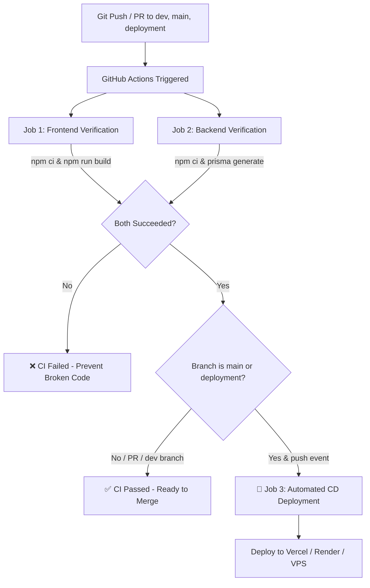

# 🚀 CI/CD Pipeline Documentation

This project uses **GitHub Actions** for automated Continuous Integration (CI) and Continuous Deployment (CD).

The workflow configuration file is located at:
📂 [`.github/workflows/ci.yml`](.github/workflows/ci.yml)

---

## 📋 Overview

---

## 🛠️ Pipeline Stages

### 1. Frontend Verification (`frontend-build`)
- **Directory**: `frontend/`
- **Runner**: `ubuntu-latest`
- **Node Version**: `20.x` with `npm` dependency caching
- **Steps**:
  1. Clones the code.
  2. Runs `npm ci` (clean install of dependencies).
  3. Executes `npm run build` with Vite.
  4. Catches syntax errors, broken imports, missing JSX tags, and bundle issues before they reach production.

### 2. Backend Verification (`backend-check`)
- **Directory**: `backend/`
- **Runner**: `ubuntu-latest`
- **Node Version**: `20.x` with `npm` dependency caching
- **Steps**:
  1. Clones the code.
  2. Runs `npm ci`.
  3. Executes `npx prisma generate` to validate database schemas and client types.
  4. Runs `node -c src/index.js` to ensure zero syntax or runtime reference issues at the server entry point.

### 3. Continuous Deployment (`deploy`)
- **Trigger**: Runs automatically only on push/merge to `main` or `deployment` branches after both verification jobs succeed.
- **Environment Support**:
  - **Vercel** (Frontend)
  - **Render** (Backend API)
  - **Hostinger VPS / Custom Linux Server** (via SSH)

---

## 🔐 Setup Deployment Secrets in GitHub

To enable automated production deployments:

1. Open your GitHub Repository:
   `https://github.com/techware-automation-india/techwareautomationindia.com`
2. Go to **Settings** → **Secrets and variables** → **Actions** → **New repository secret**.
3. Add the secrets for your chosen hosting provider:

### Option A: Render (Backend)
| Secret Name | Description | Where to get it |
| :--- | :--- | :--- |
| `RENDER_DEPLOY_HOOK_URL` | Deploy hook URL | Render Dashboard → Backend Service → Settings → **Deploy Hook** |

### Option B: Vercel (Frontend)
| Secret Name | Description | Where to get it |
| :--- | :--- | :--- |
| `VERCEL_TOKEN` | Personal Access Token | Vercel Account Settings → **Tokens** |
| `VERCEL_ORG_ID` | Organization ID | Run `vercel link` or view `.vercel/project.json` |
| `VERCEL_PROJECT_ID` | Project ID | Project Settings → General in Vercel |

### Option C: Hostinger / Ubuntu VPS (SSH)
| Secret Name | Description |
| :--- | :--- |
| `SSH_HOST` | Server IP or hostname (e.g. `195.35.x.x`) |
| `SSH_USER` | Server username (e.g. `root` or `ubuntu`) |
| `SSH_PRIVATE_KEY` | Private SSH key (`id_rsa` / `id_ed25519`) matching the server's `authorized_keys` |

---

## 🚦 Branching Strategy

| Branch | Purpose | CI/CD Behavior |
| :--- | :--- | :--- |
| `dev` | Active development & feature integration | Runs full CI checks (no auto-deploy) |
| `test` | Staging / QA testing | Can be deployed to staging |
| `deployment` | Production preparation branch | Runs full CI checks + triggers CD |
| `main` | Production live branch | Runs full CI checks + triggers CD |

---

## 🔍 How to Monitor Builds

1. Go to the **Actions** tab in your GitHub repository.
2. Select any workflow run to view real-time build logs for both frontend and backend.
3. If any step fails, GitHub Actions provides clear error messages showing the exact file and line number.
