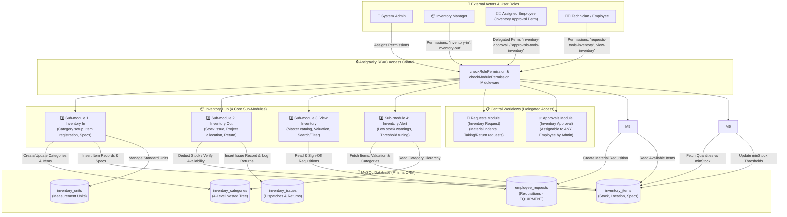

# Techware Automation INDIA — Inventory Management System (Complete Flow Documentation)

## 📌 Executive Summary

The **Inventory Management System** is a multi-tiered inventory and workshop asset management module designed for **Techware Automation INDIA**. The Inventory Hub focuses on 4 core stock sub-modules (*Inventory In*, *Inventory Out*, *View Inventory*, and *Inventory Alert*). 

To streamline workflow and allow flexible role assignments:
- **Inventory Approval** (`approvals-tools-inventory` / `inventory-approval`) has been integrated directly into the central **Approvals** module, allowing System Admins to delegate inventory requisition sign-off permissions to **ANY employee**.
- **Inventory Request** (`requests-tools-inventory` / `inventory-request`) has been integrated into the **Requests** hub for employee material indents.

---

## 🏗 System Architecture & Database Schema

The Inventory System is built on Node.js/Express, MySQL, and Prisma ORM, seamlessly integrated with a React + Vite frontend and Antigravity Role-Based Access Control (RBAC).

---

## 📊 Level-1 Flow Diagram (System Context & Architecture DFD)

The **Level-1 Flow Diagram** illustrates the high-level data flow across external actors (Admin, Inventory Manager, Assigned Approver Employee, Technician), the RBAC Middleware authentication layer, the Express API routes, and the persistent MySQL Database tables via Prisma ORM.

---

## 🔬 Level-2 Flow Diagram (Sub-Module Detailed Process Flows)

The **Level-2 Flow Diagram** details the exact step-by-step operational workflows, state transitions, validation checks, and automatic database updates for each of the 6 Inventory Sub-modules.

```mermaid
flowchart TD
    %% Sub-module 1 Flow
    subgraph SM1 ["1️⃣ Sub-module 1: Inventory In Workflow"]
        Start1([Start Inventory In]) --> Choice1{"Action Type?"}
        Choice1 -->|Category Management| CatLevel["Select Category Level\n(Level 1 Root -> Level 4 Subcategory)"]
        CatLevel --> SaveCat["Save Category (inventory_categories)"]
        
        Choice1 -->|Item Entry| ItemForm["Fill Item Details\n(Name, SKU, Photo, Location, Price)"]
        ItemForm --> AddSpecs["Add Specs (JSON) & Select Unit"]
        AddSpecs --> SaveItem["Save Inventory Item (inventory_items)"]
    end

    %% Sub-module 2 Flow
    subgraph SM2 ["2️⃣ Sub-module 2: Inventory Out Workflow"]
        Start2([Start Inventory Out]) --> Choice2{"Dispatch or Return?"}
        Choice2 -->|Material Issue| CheckStock{"Check Stock\n(Qty >= Requested?)"}
        CheckStock -->|No| StockErr["❌ Error: Insufficient Stock"]
        CheckStock -->|Yes| DeductStock["Deduct Qty from Item\n(inventory_items)"]
        DeductStock --> CreateIssue["Create Issue Record (inventory_issues)\n[Status: ISSUED]"]

        Choice2 -->|Return Item| RestockItem["Update Issue Record\n[Status: RETURNED]"]
        RestockItem --> AddStock["Increment Stock Qty back to Item"]
    end

    %% Sub-module 3 Flow
    subgraph SM3 ["3️⃣ Sub-module 3: Inventory Approval Workflow"]
        Start3([Start Approval]) --> FetchReqs["Fetch Pending EQUIPMENT Requisitions"]
        FetchReqs --> Decision{"Review Decision"}
        Decision -->|Approve| ApprReq["Update Request Status = APPROVED\nRecord Reviewer Note"]
        Decision -->|Reject| RejReq["Open Reason Modal -> Update Status = REJECTED\nRecord Rejection Reason"]
    end

    %% Sub-module 4 Flow
    subgraph SM4 ["4️⃣ Sub-module 4: View Inventory Workflow"]
        Start4([Start View Inventory]) --> LoadCatalog["Load Catalog & Summary Cards"]
        LoadCatalog --> CalcValuation["Compute Real-time Total Valuation\n(SUM(quantity * costPrice) in ₹ INR)"]
        CalcValuation --> ApplyFilters["Apply Search / Category / Location / Stock Filters"]
        ApplyFilters --> DisplayCards["Render Item Specification Cards & Stock Badges"]
    end

    %% Sub-module 5 Flow
    subgraph SM5 ["5️⃣ Sub-module 5: Inventory Request Workflow"]
        Start5([Start Request]) --> ReqType{"Request Type?"}
        ReqType -->|Taking / Return| IndentForm["Fill Indent Form\n(Item, Category, Project, Urgency)"]
        IndentForm --> SubmitIndent["Submit to employee_requests\n(type: 'EQUIPMENT', status: 'PENDING')"]
        SubmitIndent --> NotifyAppr["Forward to Sub-module 3 Approval Queue"]
    end

    %% Sub-module 6 Flow
    subgraph SM6 ["6️⃣ Sub-module 6: Inventory Alert Workflow"]
        Start6([Start Inventory Alert]) --> ScanStock["Scan All Items (Qty vs minStock)"]
        ScanStock --> Classify{"Stock Level Status"}
        Classify -->|Qty == 0| AlertCrit["🔴 CRITICAL (Zero Stock)"]
        Classify -->|0 < Qty <= minStock| AlertWarn["🟡 WARNING (Low Stock)"]
        Classify -->|Qty > minStock| AlertOK["🟢 HEALTHY (Normal Stock)"]

        AlertCrit & AlertWarn --> CalcDeficit["Compute Required Reorder Deficit\n(Deficit = minStock - Qty)"]
        CalcDeficit --> QuickAction{"Quick Action"}
        QuickAction -->|Adjust Threshold| UpdateMin["Update minStock Limit"]
        QuickAction -->|Quick Restock| RestockQty["Add Quantity to inventory_items"]
    end
```

---

### Key Prisma Data Models (`backend/prisma/schema.prisma`)

1. **`InventoryCategory`** (`inventory_categories`):
   - Supports up to **4 nested levels** (Level 1 Root $\rightarrow$ Level 2 $\rightarrow$ Level 3 $\rightarrow$ Level 4).
   - Fields: `id`, `name`, `code`, `description`, `level`, `parentId`.

2. **`InventoryItem`** (`inventory_items`):
   - Stores physical stock items at any category level.
   - Fields: `id`, `name`, `code`, `sku`, `categoryId`, `photoUrl`, `specifications` (JSON key-value pairs), `quantity`, `minStock`, `unit`, `location`, `description`, `costPrice`, `companyName`, `date`.

3. **`InventoryIssue`** (`inventory_issues`):
   - Tracks material outward dispatches and return status.
   - Fields: `id`, `inventoryItemId`, `itemName`, `assignedToPerson` / `issuedToPerson`, `companyName` / `issuedToCompany`, `projectName`, `quantity`, `issueDate`, `returnDate`, `status` (`ISSUED`, `RETURNED`, `CONSUMED`, `DAMAGED`), `notes`.

4. **`InventoryUnit`** (`inventory_units`):
   - Manages standard & custom measurement units (`Nos`, `Pcs`, `Kg`, `Meter`, `Liter`, `Box`, `Set`, `Roll`, `Packet`).

---

## 🔄 Complete Flow of the 6 Inventory Sub-modules

### 1. Sub-module 1: Inventory In (`inventory-in`)
- **Purpose**: Stock registration, category hierarchy setup, and item specification cataloging.
- **Workflow**:
  1. Create Root Categories (Level 1) or Subcategories (up to Level 4).
  2. Register items under any category level with:
     - Item Name & Code/SKU.
     - Upload Item Photo thumbnail.
     - Set initial Quantity & Unit of Measurement (`Nos`, `Kg`, `Meter`, etc.).
     - Set Minimum Stock Threshold (`minStock`).
     - Assign Physical Storage Location (e.g. *Warehouse A / Shelf 3 / Rack B*).
     - Record Unit Cost Price ($\text{costPrice}$) and Purchase Date.
     - Add up to 5 custom key-value specifications (e.g., `Voltage: 24V`, `Material: SS304`, `Stroke: 100mm`).

---

### 2. Sub-module 2: Inventory Out (`inventory-out`)
- **Purpose**: Material outward dispatches, project allocations, and stock return tracking.
- **Workflow**:
  1. **Stock Outward Dispatch**:
     - Click **"Issue Material / Stock Out"**.
     - Select registered item from catalog or enter item name.
     - Enter recipient person name (`issuedToPerson`) and target project/company (`issuedToCompany`).
     - Enter dispatch quantity. The system validates available stock (`quantity >= requestedQuantity`) and deducts stock from inventory automatically (`quantity = quantity - issueQty`).
  2. **Return & Restock Workflow**:
     - When an issued tool or component is returned, click **"Return"**.
     - The system updates issue status to `RETURNED`, records `returnDate`, and automatically increments stock quantity back into inventory (`quantity = quantity + returnedQty`).

---

### 3. Sub-module 3: Inventory Approval (`inventory-approval`)
- **Purpose**: Requisition review and sign-off workflow for admins & inventory managers.
- **Workflow**:
  1. Displays all material requisitions raised by employees or project engineers.
  2. Filter by status (`PENDING`, `APPROVED`, `REJECTED`) or urgency (`Normal`, `Urgent`, `Emergency`).
  3. **Approve Action**: Click **"Approve Requisition"** to approve the request with an optional reviewer sign-off note.
  4. **Reject Action**: Click **"Reject Requisition"** to open the rejection modal and enter a formal rejection reason.

---

### 4. Sub-module 4: View Inventory (`view-inventory`)
- **Purpose**: Master stock catalog, real-time valuation summary, and location filter.
- **Workflow**:
  1. Displays real-time summary cards:
     - **Total SKU Items**.
     - **Total Units in Stock**.
     - **Estimated Inventory Value** ($\sum \text{quantity} \times \text{costPrice}$ in ₹ INR).
     - **Low / Out Stock Alerts Summary**.
  2. Search catalog by item name, SKU, location, or custom specification attributes.
  3. Filter by Category or Stock Status (`In Stock`, `Low Stock`, `Out of Stock`).
  4. Inspect full item cards showing item photo, SKU, category breadcrumb, physical location, and line item valuation.

---

### 5. Sub-module 5: Inventory Request (`inventory-request`)
- **Purpose**: Material indents & requisition form for workshop technicians and project teams.
- **Workflow**:
  1. Click **"Raise Material Request / Indent"**.
  2. Select Requisition Type:
     - `Taking` (Stock Issue Request for assembly or maintenance).
     - `Return` (Stock Return Request for completed project tools).
  3. Select Item from catalog or enter item name.
  4. Select Category (`Tools`, `Project Material`, `Consumables`, `Spare Parts`) and Product Type (`Mechanical`, `Electrical`, `Pneumatic`, `Electronic`).
  5. Enter Target Project Name (e.g. *AutoCard Assembly Line 1*).
  6. Select Urgency Priority (`Normal`, `Urgent`, `Emergency`) and state purpose.
  7. Requisition is submitted to `EmployeeRequest` table with `type: "EQUIPMENT"` and awaits approval in Sub-module 3.

---

### 6. Sub-module 6: Inventory Alert (`inventory-alert`)
- **Purpose**: Low stock warnings, zero-stock critical alerts, and minimum threshold limit adjustments.
- **Workflow**:
  1. Monitors stock levels against minimum limits (`minStock`).
  2. Categorizes stock items into 3 alert states:
     - **CRITICAL** ($\text{quantity} = 0$): Out of stock, production blocked.
     - **WARNING** ($0 < \text{quantity} \le \text{minStock}$): Low stock warning.
     - **HEALTHY** ($\text{quantity} > \text{minStock}$): Stock level normal.
  3. Calculates required reorder deficit ($\text{minStock} - \text{quantity}$).
  4. **Adjust Limit / Quick Restock**: Click on any alert card to adjust `minStock` threshold limits or quickly add fresh incoming stock.

---

## 🔐 Permission Keys & Access Control (RBAC)

The Inventory System is protected on both backend middleware and frontend routes using the following granular module keys:

| Permission Key | Description | Accessible Sub-module |
|---|---|---|
| `inventory` | Master Inventory Access | Full access to all 6 sub-modules |
| `inventory-in` | Sub-module 1 | Inventory In (Category & Item Entry) |
| `inventory-out` | Sub-module 2 | Inventory Out (Dispatches & Allocation) |
| `inventory-approval` / `approvals-tools-inventory` | Sub-module 3 | Inventory Approval (Requisition Sign-Off) |
| `view-inventory` | Sub-module 4 | View Inventory (Master Catalog & Valuation) |
| `inventory-request` / `requests-tools-inventory` | Sub-module 5 | Inventory Request (Material Indents) |
| `inventory-alert` | Sub-module 6 | Inventory Alert (Low Stock Warnings) |

---

## 📡 API Endpoints Reference

### 1. Categories & Hierarchy
- `GET /api/inventory/categories` — List categories with children & item counts.
- `GET /api/inventory/categories/:id` — Get single category details.
- `POST /api/inventory/categories` — Create category (Level 1 to 4).
- `PUT /api/inventory/categories/:id` — Update category.
- `DELETE /api/inventory/categories/:id` — Delete category.

### 2. Units & Uploads
- `GET /api/inventory/units` — List measurement units.
- `POST /api/inventory/units` — Add custom measurement unit.
- `POST /api/inventory/upload` — Upload item photo image file.

### 3. Items & Catalog
- `GET /api/inventory/items` — List all catalog items with category ref.
- `GET /api/inventory/items/:id` — Get single item details.
- `POST /api/inventory/items` — Create new inventory item.
- `PUT /api/inventory/items/:id` — Update item quantity, minStock, location, specs.
- `DELETE /api/inventory/items/:id` — Delete item.

### 4. Material Outward & Issues
- `GET /api/inventory/issues/all` — List all material dispatches & allocations.
- `POST /api/inventory/issues` — Issue material (deducts stock).
- `PUT /api/inventory/issues/:id` — Update issue status / Return item (restocks stock).
- `DELETE /api/inventory/issues/:id` — Delete issue record.

### 5. Requisitions & Approval Sign-Off
- `GET /api/requests` — List requisitions (includes `type: "EQUIPMENT"`).
- `POST /api/requests` — Submit material request indent.
- `POST /api/requests/:id/approve` — Approve material requisition.
- `POST /api/requests/:id/reject` — Reject material requisition with note.

---

## 🧪 Verification & Build Status

- **Database Sync**: Verified using `npx prisma db push`.
- **Frontend Production Build**: Verified using `npm run build` — **0 compilation/type errors** (`✓ built cleanly`).
